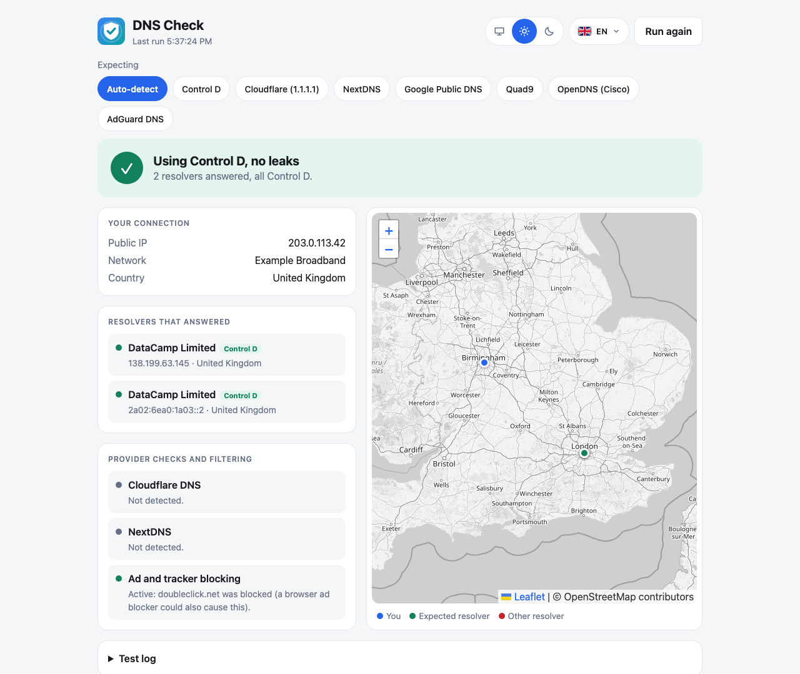
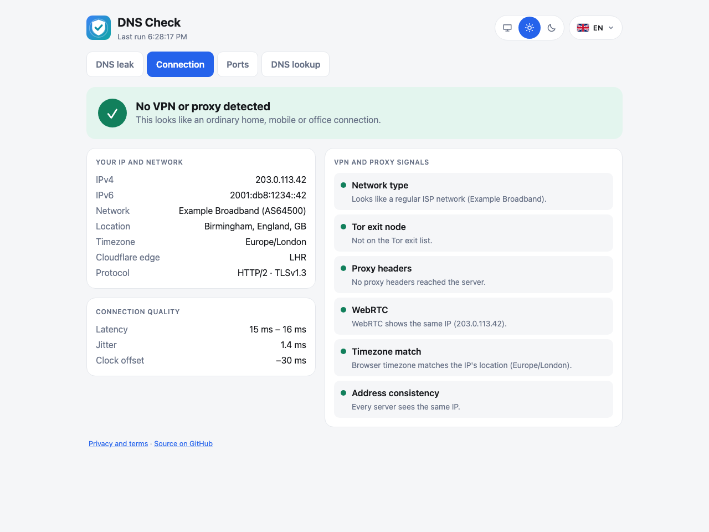
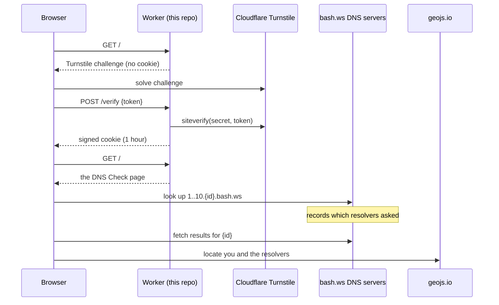

<div align="center">


# DNS Check

**See which DNS resolvers your device really uses, and whether anything is leaking.**

[](https://dns.peacock665.co.uk)
[](https://workers.cloudflare.com)
[](https://developers.cloudflare.com/turnstile/)
[](LICENSE)


[**Live site**](https://dns.peacock665.co.uk) · [Privacy and terms](https://dns.peacock665.co.uk/privacy)

<picture>
  <source media="(prefers-color-scheme: dark)" srcset="docs/screenshot-ok-dark.png">
  
</picture>

</div>

## What it does

Made for people who send their DNS through [Control D](https://controld.com) and want proof that it's working, but it works for any resolver: the page names every one that answered.

- **Leak test.** Your browser looks up 10 random names; the resolvers that ask for them are recorded and shown, with provider and country.
- **Provider detection.** Each resolver is named: Control D, Cloudflare (1.1.1.1), NextDNS, Google, Quad9, OpenDNS or AdGuard. Pick the one you expect, or leave it on auto-detect, and anything else turns the banner red.
- **Provider check.** Direct confirmation for Cloudflare DNS, using the test host Cloudflare publishes.
- **Map.** You, your resolvers and any stray resolver on a greyscale map, so the pins are the only colour.
- **Connection tab.** What the Cloudflare edge sees about you (IP, network, location, protocol), a VPN / proxy / Tor check built from the network owner, proxy headers, the Tor exit list, WebRTC, timezone and address consistency, plus IPv6, latency, jitter and clock offset.
- **Port check.** TCP check of *your own* public IP from Cloudflare's network, with presets or custom ports (up to 25). The target is never read from the request, so it can't be used to scan anyone else.
- **DNS lookup.** A, AAAA, MX, TXT, NS, CNAME and reverse (PTR) lookups over DNS-over-HTTPS to 1.1.1.1.
- **Filtering check.** Tells you whether an ad and tracker domain is being blocked.
- **Test log.** The resolver table and a plain-text log of the run, like the results page on dnsleaktest.com.
- **Bot check.** Cloudflare Turnstile guards the page, verified by the Worker, not just shown.
- **System, light and dark theme** switcher, and **11 languages** (English, French, German, Spanish, Italian, Brazilian Portuguese, Dutch, Japanese, Korean, Simplified and Traditional Chinese) with the same flag picker as my other projects. A slowly drifting animated background (off for reduced-motion settings) and a footer with the tools, project and legal links. Phone friendly, no accounts, no analytics.

<div align="center">
<picture>
  
</picture>
<br><sub>A stray resolver gets flagged and shown on the map.</sub>
</div>

<div align="center">
<picture>
  <source media="(prefers-color-scheme: dark)" srcset="docs/screenshot-connection-dark.png">
  
</picture>
<br><sub>The Connection tab: your IP, network and six VPN and proxy signals. (Screenshot uses fictional data.)</sub>
</div>

## How it works



The Worker is the gate: every URL serves the challenge until the visitor holds a valid HMAC-signed cookie, issued only after Cloudflare confirms the Turnstile token. The icons and the privacy page are public. The test itself runs in the browser, so your lookups come from your own device and resolver.

## Run it locally

You need Node 20+ and a Cloudflare account only if you deploy.

```bash
git clone https://github.com/Ol775/dns-check.git
cd dns-check
cp .dev.vars.example .dev.vars
npx wrangler dev
```

`.dev.vars.example` holds Cloudflare's published [test keys](https://developers.cloudflare.com/turnstile/troubleshooting/testing/) (the secret always passes, and the matching test sitekey overrides the real one in `wrangler.jsonc`) plus a throwaway cookie key, for local use only. Open `http://localhost:8787`.

## Deploy your own

1. Create a Turnstile widget for your hostname in the Cloudflare dashboard.
2. In [`wrangler.jsonc`](wrangler.jsonc), set `TURNSTILE_SITEKEY` to the widget's sitekey and change the route to your own domain.
3. Deploy and store the widget's secret:

```bash
npx wrangler deploy
npx wrangler secret put TURNSTILE_SECRET
openssl rand -hex 32 | npx wrangler secret put COOKIE_SECRET
```

`COOKIE_SECRET` signs the access cookie and is separate from the Turnstile secret. Without both secrets the Worker serves nothing.

If the domain sits behind Cloudflare Access, add a bypass for it or visitors will hit the Access login first.

## Project layout

```
src/worker.js          Turnstile gate: /verify, signed cookie, security headers, routes
src/net.js             /api/me, /api/ping, /api/ports (TCP port check of the caller's own IP)
public/index.html      the page: markup and CSS
public/app.js          DNS leak test
public/tools.js        tabs, connection / VPN / proxy check, port check, DNS lookup
public/privacy.html    privacy policy and terms
public/ui.js           theme + language switchers and every UI string
public/cookie-notice.js  informational cookie notice
public/icon.svg …      logo and favicons
wrangler.jsonc         Worker config
```

No framework and no build step (`ui.js` holds the translations; the privacy page is English only). The only dependency is [Leaflet](https://leafletjs.com) for the map, loaded from cdnjs with integrity hashes.

## Limits

- Providers are recognised by the organisation name of the resolver's IP address, which is a heuristic. Edit the `PROVIDERS` list in `public/index.html` to add one or fix a match. A resolver that isn't on the list shows as "Unrecognised", which is usually your ISP or router.
- Cloudflare's family servers (1.1.1.2 and 1.1.1.3) look the same as 1.1.1.1 from a browser, so they can't be told apart.
- NextDNS is recognised by the resolver's name only: its test page sends no CORS headers, so a browser can't read it for a direct confirmation.
- It reports the resolvers that answered during the run. A leak that only shows up in certain apps, or when a VPN toggles, can be missed.
- A VPN or iCloud Private Relay changes what you see.
- VPN and proxy detection is a heuristic: it reads the network owner's name and a few signals, so it will miss some VPNs and flag some business or cloud connections. Treat it as a hint.
- The port check tests TCP only (no UDP, so WireGuard and game servers can't be checked) and, being a check from outside, reports closed ports behind CGNAT or an un-forwarded router.
- DNSSEC isn't tested: no public test host has a valid HTTPS certificate, so a browser can't tell a DNS refusal from a certificate error.

## Security

- Every URL serves the challenge until a valid signed cookie is presented; forged, tampered and expired cookies are rejected (HttpOnly, Secure, SameSite=Lax, one hour).
- Strict CSP (no inline scripts, an allow-list of the hosts the app talks to), HSTS, `X-Frame-Options: DENY`, `nosniff`, a referrer policy and a permissions policy on every response.
- The port check only ever targets the caller's own IP, needs a same-origin POST with the access cookie, and is limited to 25 ports and 6 checks a minute per IP.
- `/verify` caps the body (4 KB) and token (2048 characters), and is rate limited to 10 attempts a minute per IP. Cloudflare's rate limiter is per location and approximate: it blunts abuse rather than guaranteeing a hard cap.
- Values from third-party services are escaped or set as plain text, never inserted as HTML.
- The Turnstile script can't be pinned with an integrity hash, because Cloudflare serves it dynamically; Leaflet is pinned.

Found a problem? Please message Ol775 on GitHub rather than opening a public issue.

## Privacy

The site stores nothing about you. Your browser talks to bash.ws (resolver detection), geojs.io (map locations), OpenStreetMap (tiles) and Cloudflare, and the ad-blocking check requests an advertising domain on purpose. Everything is listed in the [privacy policy](public/privacy.html).

## Contributing

Issues and pull requests are welcome. To add a resolver provider, add a line to `PROVIDERS` in `public/index.html`; to add a language, add its strings to `public/ui.js`.

## Credits

[bash.ws](https://bash.ws) for the leak-test DNS servers · [GeoJS](https://www.geojs.io) for IP locations · [OpenStreetMap](https://www.openstreetmap.org) contributors for the map · [Leaflet](https://leafletjs.com) · [Cloudflare](https://www.cloudflare.com) Workers and Turnstile. Not affiliated with Control D.

## License

[MIT](LICENSE)
