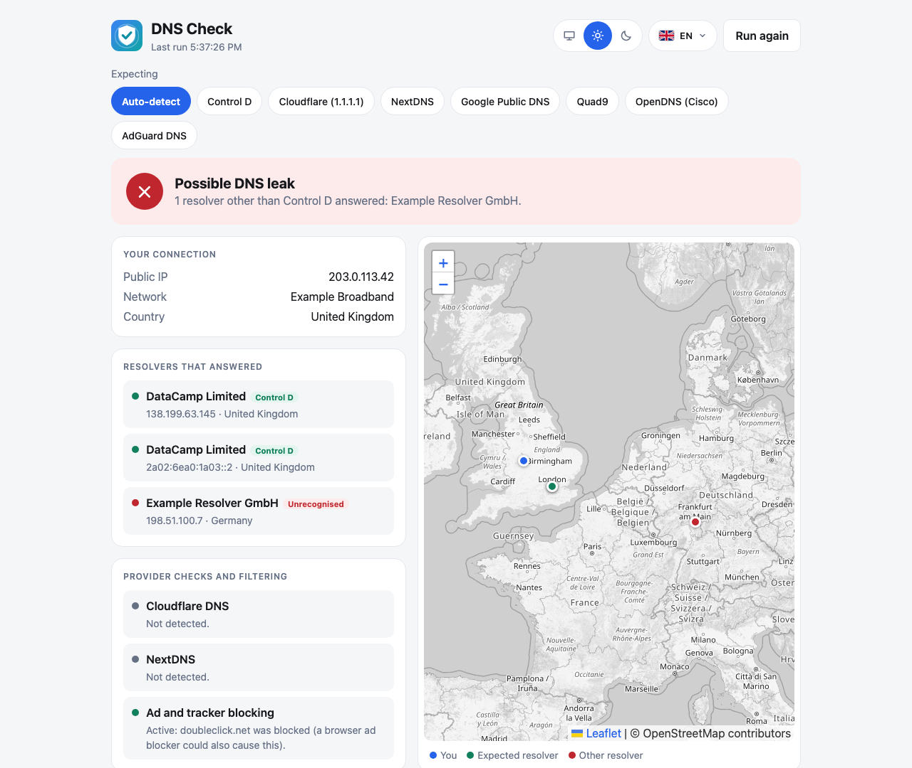
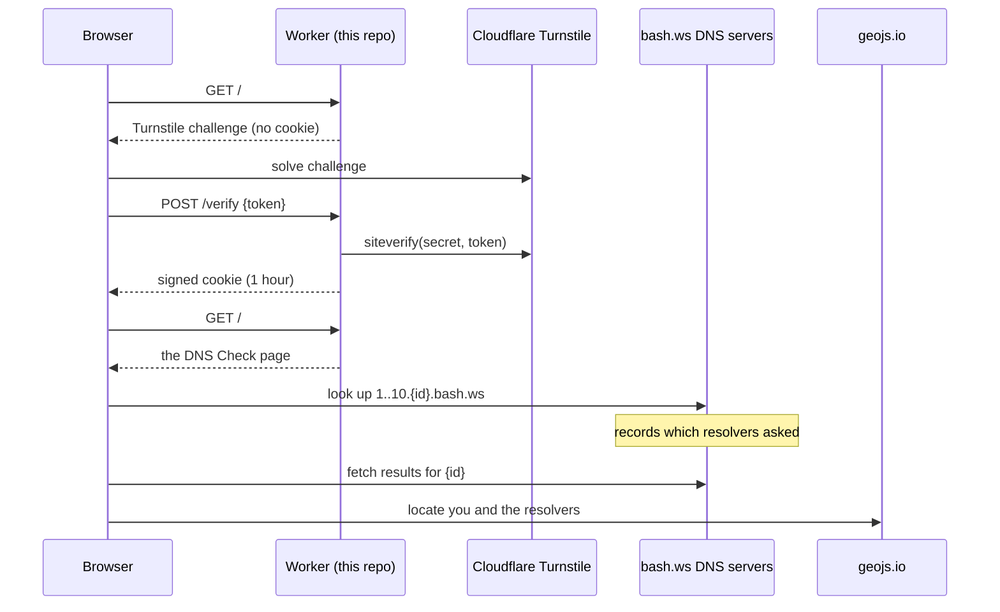

<div align="center">


# DNS Check

**See which DNS resolvers your device really uses, and whether anything is leaking.**

[](https://dns.peacock665.co.uk)
[](https://workers.cloudflare.com)
[](https://developers.cloudflare.com/turnstile/)
[](LICENSE)


[**Live site**](https://dns.peacock665.co.uk) · [Privacy and terms](https://dns.peacock665.co.uk/privacy)

<picture>
  <source media="(prefers-color-scheme: dark)" srcset="docs/screenshot-ok-dark.png">
  
</picture>

</div>

## What it does

Made for people who send their DNS through [Control D](https://controld.com) and want proof that it's working, but it works for any resolver: the page names every one that answered.

- **Leak test.** Your browser looks up 10 random names; the resolvers that ask for them are recorded and shown, with provider and country.
- **Provider detection.** Each resolver is named: Control D, Cloudflare (1.1.1.1), NextDNS, Google, Quad9, OpenDNS or AdGuard. Pick the one you expect, or leave it on auto-detect, and anything else turns the banner red.
- **Provider checks.** Direct confirmation for Cloudflare DNS and NextDNS, using the test hosts those services publish.
- **Map.** You, your resolvers and any stray resolver on a greyscale map, so the pins are the only colour.
- **Filtering check.** Tells you whether an ad and tracker domain is being blocked.
- **Test log.** The resolver table and a plain-text log of the run, like the results page on dnsleaktest.com.
- **Bot check.** Cloudflare Turnstile guards the page, verified by the Worker, not just shown.
- **System, light and dark theme** switcher, and **11 languages** (English, French, German, Spanish, Italian, Brazilian Portuguese, Dutch, Japanese, Korean, Simplified and Traditional Chinese) with the same flag picker as my other projects. Phone friendly, no accounts, no analytics.

<div align="center">
<picture>
  
</picture>
<br><sub>A stray resolver gets flagged and shown on the map.</sub>
</div>

## How it works



The Worker is the gate: every URL serves the challenge until the visitor holds a valid HMAC-signed cookie, issued only after Cloudflare confirms the Turnstile token. The icons and the privacy page are public. The test itself runs in the browser, so your lookups come from your own device and resolver.

## Run it locally

You need Node 20+ and a Cloudflare account only if you deploy.

```bash
git clone https://github.com/Ol775/dns-check.git
cd dns-check
echo 'TURNSTILE_SECRET=1x0000000000000000000000000000000AA' > .dev.vars
npx wrangler dev
```

`.dev.vars` uses Cloudflare's published [test secret](https://developers.cloudflare.com/turnstile/troubleshooting/testing/), which always passes. Set `TURNSTILE_SITEKEY` in [`wrangler.jsonc`](wrangler.jsonc) to the matching test sitekey `1x00000000000000000000AA` for local use.

## Deploy your own

1. Create a Turnstile widget for your hostname in the Cloudflare dashboard.
2. In [`wrangler.jsonc`](wrangler.jsonc), set `TURNSTILE_SITEKEY` to the widget's sitekey and change the route to your own domain.
3. Deploy and store the widget's secret:

```bash
npx wrangler deploy
npx wrangler secret put TURNSTILE_SECRET
```

If the domain sits behind Cloudflare Access, add a bypass for it or visitors will hit the Access login first.

## Project layout

```
src/worker.js          Turnstile gate: /verify, signed cookie, public paths
public/index.html      the whole app: one file, inline CSS and JS
public/privacy.html    privacy policy and terms
public/ui.js           theme + language switchers and every UI string
public/cookie-notice.js  informational cookie notice
public/icon.svg …      logo and favicons
wrangler.jsonc         Worker config
```

No framework and no build step (`ui.js` holds the translations; the privacy page is English only). The only dependency is [Leaflet](https://leafletjs.com) for the map, loaded from cdnjs with integrity hashes.

## Limits

- Providers are recognised by the organisation name of the resolver's IP address, which is a heuristic. Edit the `PROVIDERS` list in `public/index.html` to add one or fix a match. A resolver that isn't on the list shows as "Unrecognised", which is usually your ISP or router.
- Cloudflare's family servers (1.1.1.2 and 1.1.1.3) look the same as 1.1.1.1 from a browser, so they can't be told apart.
- The NextDNS check needs NextDNS's test page to be readable from a browser; if it isn't, the check says "Not detected" even when you are on NextDNS.
- It reports the resolvers that answered during the run. A leak that only shows up in certain apps, or when a VPN toggles, can be missed.
- A VPN or iCloud Private Relay changes what you see.
- DNSSEC isn't tested: no public test host has a valid HTTPS certificate, so a browser can't tell a DNS refusal from a certificate error.

## Privacy

The site stores nothing about you. Your browser talks to bash.ws (resolver detection), geojs.io (map locations), OpenStreetMap (tiles) and Cloudflare, and the ad-blocking check requests an advertising domain on purpose. Everything is listed in the [privacy policy](public/privacy.html).

## Credits

[bash.ws](https://bash.ws) for the leak-test DNS servers · [GeoJS](https://www.geojs.io) for IP locations · [OpenStreetMap](https://www.openstreetmap.org) contributors for the map · [Leaflet](https://leafletjs.com) · [Cloudflare](https://www.cloudflare.com) Workers and Turnstile. Not affiliated with Control D.

## License

[MIT](LICENSE)
